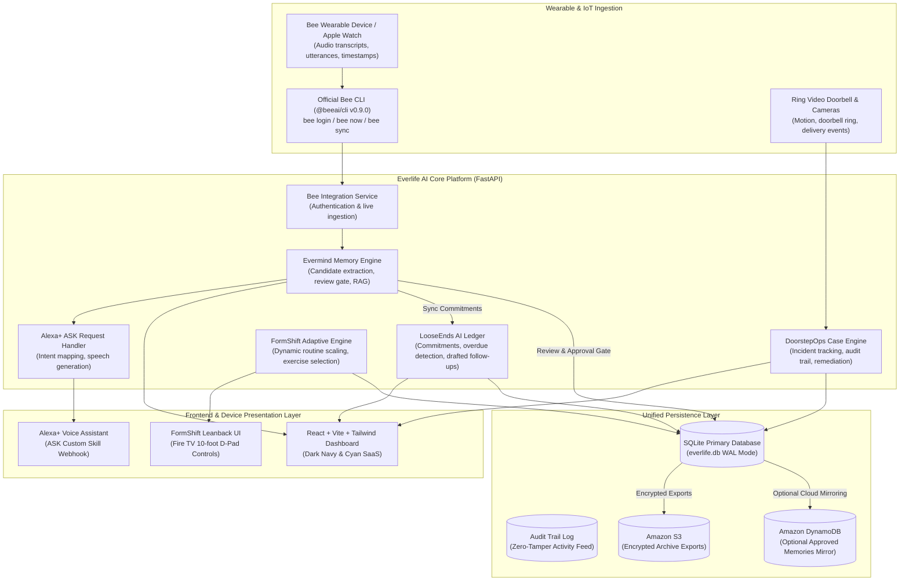

# Everlife AI Architecture Specification
**Team Identity:** TEAM ORYVAN  
**Product Name:** Everlife AI  
**AI Memory Engine:** Evermind  
**Tagline:** Your life, connected. Your context, remembered.  
**Event:** Amazon Developer Hackathon 2026  
**Primary Track:** Bee Wearable AI  

---

## 1. High-Level Architecture Diagram

---

## 2. Core Modules & Responsibilities

### 2.1 Evermind Memory Engine (`backend/app/services/evermind_engine.py`)
- **Ingestion:** Parses live utterances from the official Bee CLI (`bee now --json`) or uploaded wearable recordings.
- **Extraction:** Isolates candidate facts, tasks, decisions, and commitments with explicit source references and timestamps.
- **Review & Approval Gate:** Enforces zero-fabrication. Memories remain in `pending` status until human review.
- **Natural Language Search (RAG):** Retrieves verified memories and grounds answers citing exact source quotes, timestamps, and confidence scores.

### 2.2 LooseEnds AI (`backend/app/services/looseends_engine.py`)
- **Ledger:** Maintains a persistent ledger of unresolved promises and commitments.
- **Overdue Tracking:** Detects elapsed deadlines using ISO timestamps.
- **Follow-up Dispatch Gate:** Generates automated follow-up drafts, but strictly requires explicit user confirmation before dispatching.

### 2.3 DoorstepOps (`backend/app/services/doorstepops_service.py`)
- **Ring Integration:** Conforms to `developer.ring.com` partner specifications.
- **Case Tracking:** Manages perimeter security events (`motion`, `doorbell_ring`, `package_delivery`, `access_attempt`, `unauthorized_entry`) with severity-based escalation.

### 2.4 FormShift (`backend/app/services/formshift_service.py`)
- **Fire TV Leanback Interface:** Conforms to Amazon Fire TV 10-foot web app UI guidelines.
- **Real-Time Adaptation:** Responds to D-Pad navigation (`Easier`, `Harder`, `Shorter`, `Skip`) to dynamically rebalance workout routines.

### 2.5 Alexa+ Service (`backend/app/services/alexa_service.py`)
- Exposes standard Amazon Alexa Skills Kit (ASK) endpoints for memory recall, commitment reviews, incident alerts, and workout launching.

---

## 3. Security, Privacy, and Audit Controls
1. **Local-First Default:** All data resides in `backend/data/everlife.db` under local user custody.
2. **Zero-Fabrication Guarantee:** Candidate memories require explicit user confirmation.
3. **No Unconfirmed Consequential Actions:** Automated messages or calendar schedules require explicit confirmation.
4. **GDPR/Privacy Rights:** Full structured JSON export and one-click data wipe endpoints are available.
